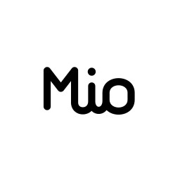

<p align="center">
  
</p>

# Mio

Mio 是一个 macOS 14.2+ 菜单栏应用，使用 Core Audio Process Tap 调节正在播放音频的单个应用音量。

## 运行

1. 使用 Xcode 打开 `Mio.xcodeproj`。
2. 在 Mio target 的 Signing & Capabilities 中选择开发团队。
3. 运行应用，并在首次调节音量时允许系统音频录制权限。
4. 从菜单栏 Mio 字标打开 Mio。

仓库中的 `build/Mio.app` 是本机临时签名的通用构建，可直接用于当前机器验证。正式分发前需要换成 Developer ID 签名并完成公证。

## 开发模式

安装并选择 Xcode 后，在项目根目录执行：

```sh
./run-dev.sh
```

脚本使用 Debug 配置，只构建当前 Mac 的架构，复用 `build/DevDerivedData` 进行增量编译，并使用本机 ad-hoc 签名，无需选择开发团队。构建成功后在当前终端运行 Mio，运行日志直接输出到终端。按 `r` 重新构建并重启，按 `q` 或 `Ctrl+C` 退出开发模式并停止本次启动的 Mio；无需按回车。Mio 是菜单栏应用，启动后从菜单栏 Mio 字标打开；首次调节音量时需要允许系统音频录制权限。运行前请退出已启动的 Mio，修改代码后回到终端按 `r`。重启构建失败时可继续按 `r` 重试；从菜单栏退出应用后，开发脚本也会保留并等待下一次操作。

仅构建、不启动：

```sh
./run-dev.sh --build-only
```

构建日志位于 `build/dev-build.log`，开发构建与安装包脚本使用的 Release 产物分开存放。可使用 `./run-dev.sh --help` 查看用法。

## 主窗口键盘操作

打开音量面板后，默认选中首个应用，并以淡色高亮当前选项：

- `↑` / `↓`：切换应用，到达首尾时停留。
- `←` / `→`：降低 / 提高所选应用的音量，沿用设置中的“每次调整”步长，支持长按连续调整。
- 点击应用行、拖动滑杆或点击静音按钮也会选中该应用；键盘切换时列表会自动滚动到选中项。

方向键只在音量面板获得焦点时生效，静音中的应用与禁用的滑杆保持一致，不通过方向键改变音量。

## 设置与快捷键

点击音量面板左下角的齿轮打开设置。默认全局快捷键为 `⌃⌥M`，用于唤出或收起同一个音量面板。点击快捷键框后按下新的组合键即可保存，支持清除和恢复默认；录制时按 `Esc` 取消、`Delete` 清除。组合键至少包含 `⌘`、`⌃`、`⌥` 之一。配置会在重启后保留，遇到占用冲突会提示并保留原配置。应用运行时无需额外的辅助功能权限。

默认 `⌃⌥↑` 微增、`⌃⌥↓` 微减系统全局音量。在设置的“每次调整”中配置 0.5%–5% 的步长，默认为 1%。三组快捷键均可独立修改、清除和恢复默认，应用内重复组合键也会提示冲突。调整时短暂显示实际音量百分比，不切换当前应用焦点。每次调整都读取当前默认输出设备；不支持软件音量的 HDMI / 数字输出会显示提示。

全局音量归零时会同步开启设备支持的系统静音，再次提高音量时先设置起步音量，再取消静音。浮层将非零音量至少显示为 `1%`，避免四舍五入后误显示 `0%`；设备忽略静音写入时会显示错误提示。

快捷键行为检查（包含实际系统注册、冲突回退、持久化、三组事件回调和步长边界）：

```sh
mkdir -p build
xcrun swiftc Mio/ShortcutSettings.swift Tests/ShortcutSettingsChecks.swift -o build/shortcut-checks
./build/shortcut-checks
```

系统音量逻辑检查（使用模拟设备，不改动本机音量）：

```sh
xcrun swiftc Mio/Audio/CoreAudioHelpers.swift Mio/Audio/SystemVolumeController.swift Tests/SystemVolumeChecks.swift -o build/system-volume-checks
./build/system-volume-checks
```

## 应用图标

应用图标使用连笔 Mio 字标，菜单栏使用同款透明底字标并随系统深浅色自动切换；音量面板左上角使用与菜单栏一致的透明底字标，不显示额外文字标题。

应用图标矢量源文件位于 `Mio/Assets.xcassets/MioLogo.imageset/MioLogo.svg`，各尺寸图标保存在 `Mio/Assets.xcassets/AppIcon.appiconset`；菜单栏与面板字标使用 `Mio/Assets.xcassets/MioMenuBar.imageset`。

## macOS 26 界面

界面已适配 macOS 26 Liquid Glass。使用 Xcode 26 或更高版本构建时，控制按钮、状态徽标和容器会启用原生 `GlassEffectContainer` 与 `glassEffect`，图标按钮采用紧凑圆形样式；使用旧版 Xcode 构建时会自动采用 Material 兼容样式，音频功能保持一致。

## 当前范围

- 自动显示正在输出音频的进程。
- 单进程音量和静音。
- 按 Bundle ID 保存音量。
- 使用可配置的全局快捷键精细调整系统输出音量。
- 默认输出设备变化时自动重建控制管线。
- 音量恢复到 100% 时释放 Process Tap。

浏览器、Electron 和会议软件可能由 Helper 进程实际输出音频，因此列表中可能显示 Helper 名称。当前版本支持常见的线性 PCM 格式；多声道和特殊数字输出需要进一步兼容性测试。
